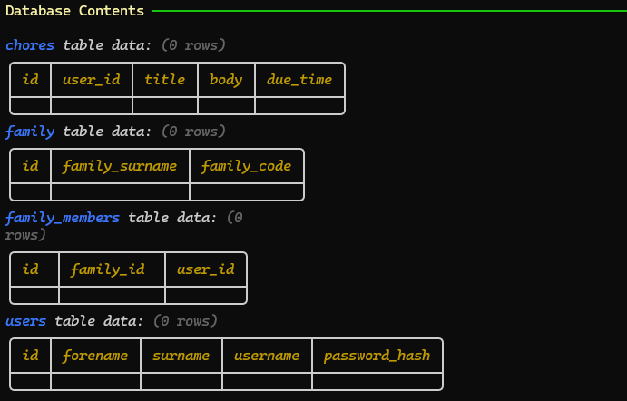
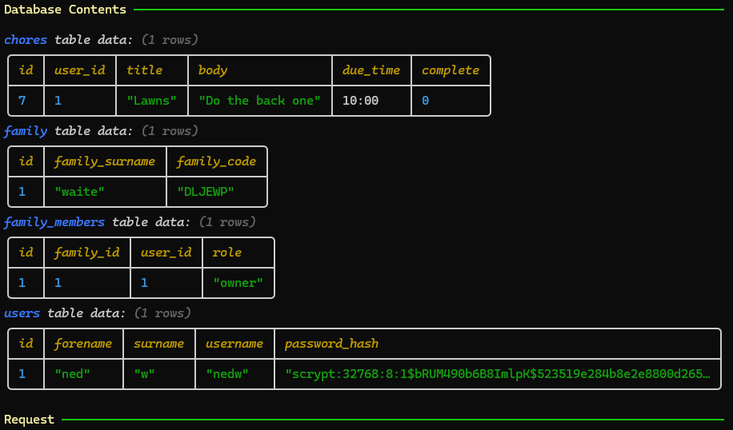
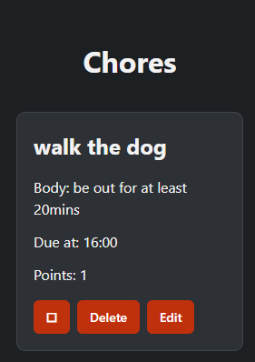
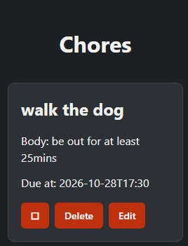
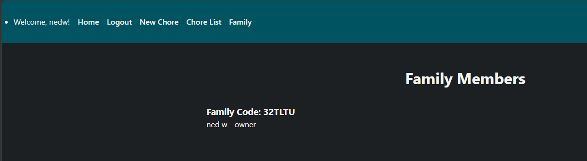

# Sprint 2 - Implement Database and Display of Test Data

## Sprint Goals

Implement the database, populated with test data. Create queries that retrieve test data, and display this on web pages as needed. Test and refine the queries and data display, so that it stands as the basis of the next sprint.

### Specific Goals

**Edit these goals as needed**

- Implement the database
- Add test data to the database
- Create the following web pages:
    - Home pages showing...
    - Details page for ...
    - Etc.
- Develop SQL database queries to:
    - Retrieve all ...
    - Retrieve specific ...
    - Etc.

## Testing Database and test data

I am testing to see if the database has the correct tables, columns and data inside.

### Changes / Improvements

I added a complete column to allow the user to say its done and a role column so that there would be owners and members giving certain privileges.

## Testing Displaying chores

I am going to open my Chore List page and check that the chore titles, bodys, due times and points display correctly.

### Changes / Improvements

I decided to remove the point system I didnt like the idea and improved the due time to a calender that gives you options for the exact date and time

## Testing Displaying family members

I will open the Family page and check that the family code, names and roles display correctly.

### Changes / Improvements

No changes were required following testing, as the feature worked as expected. The test results confirmed that the feature functioned correctly.

## ETC...

## Sprint Review

Replace this text with a statement about how the sprint has moved the project forward - key success point, any things that didn't go so well, etc.

