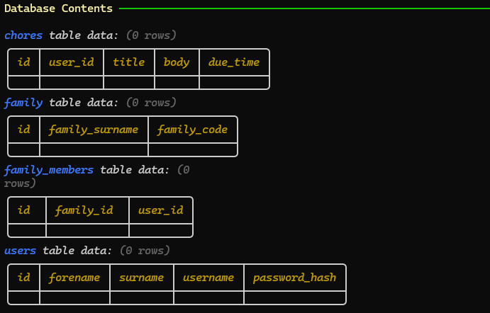
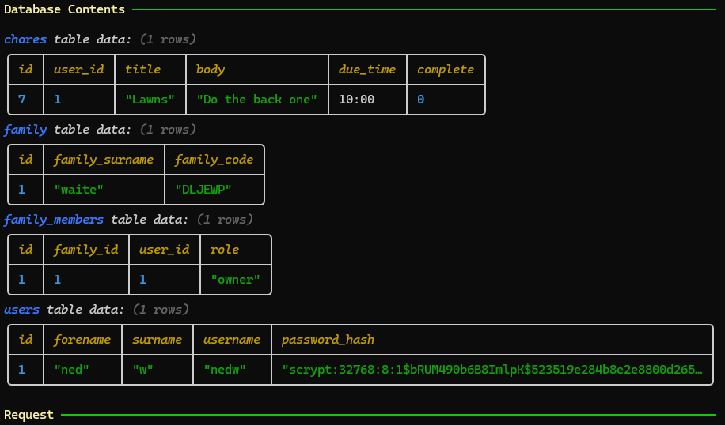
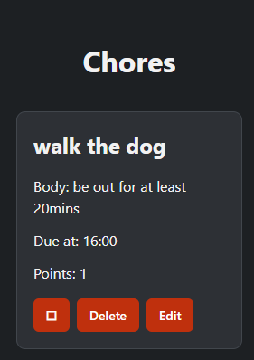
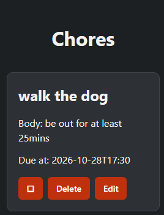
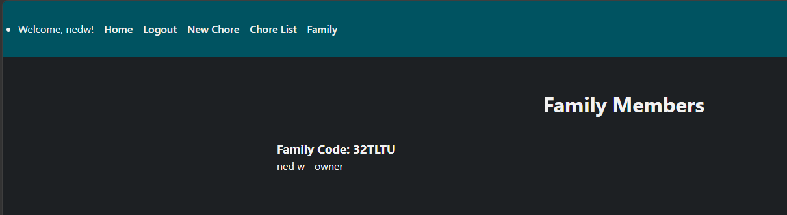
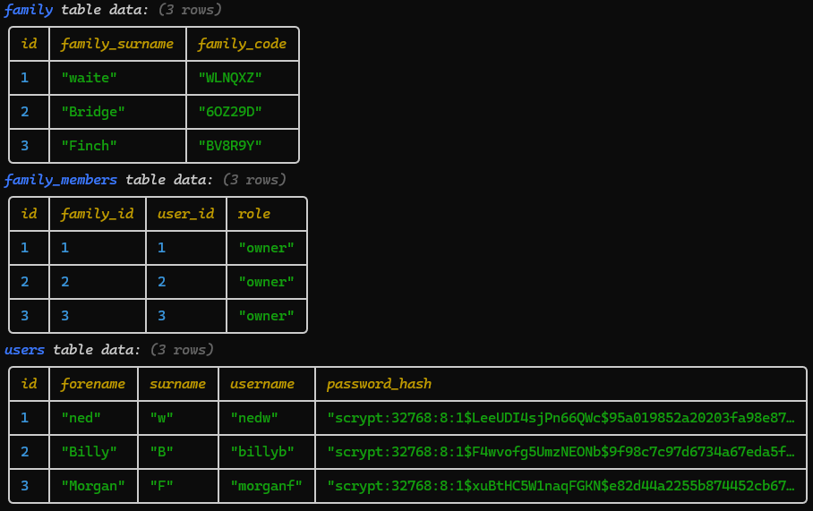

# Sprint 2 - Implement Database and Display of Test Data

## Sprint Goals

Implement the database, populated with test data. Create queries that retrieve test data, and display this on web pages as needed. Test and refine the queries and data display, so that it stands as the basis of the next sprint.

### Specific Goals

- Test the database structure:
    - Check that the required tables and columns exist.
    - Check that data is being stored correctly.
    - Test database relationships and user roles.
    - Make changes to the database where necessary.

- Test displaying database information:
    - Check that chore titles, descriptions and due dates display correctly.
    - Check that family members, names, family codes and roles display correctly.
    - Check that multiple families are stored separately.

- Test and improve functionality:
    - Check that users can mark chores as complete.
    - Test that owners and members have the correct permissions.
    - Improve features based on testing results.
    - Fix any problems found during testing.

## Testing Database and test data

I am testing to see if the database has the correct tables, columns and data inside.

### Changes / Improvements

I added a complete column to allow the user to say its done and a role column so that there would be owners and members giving certain privileges.

## Testing Displaying chores

I am going to open my Chore List page and check that the chore titles, bodys, due times and points display correctly.

### Changes / Improvements

I decided to remove the point system I didnt like the idea and improved the due time to a calender that gives you options for the exact date and time

## Testing Displaying family members

I will open the Family page and check that the family code, names and roles display correctly.

### Changes / Improvements

No improvements or changes were required because the feature worked as expected as the test results showed it worked as intended

## Testing if the Database shows all families

I am going to open the terminal to see if it displays 3 individual families to show that it stores it correctly

### Changes / Improvements

No improvements or changes were required because the feature worked as expected as the test results showed it worked as intended

## Sprint Review

This sprint helped move the project forward by me finding things I didnt and did like within my website and also allowing me to test many features to make sure they
work correctly and well

