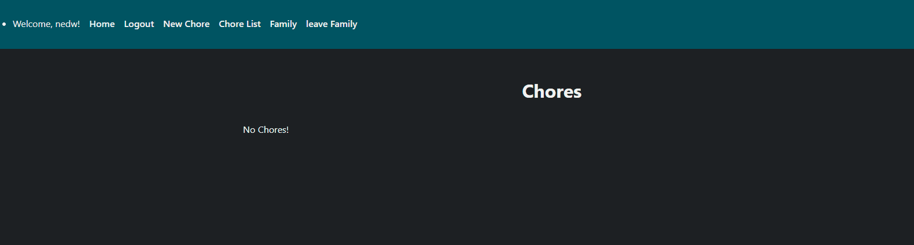
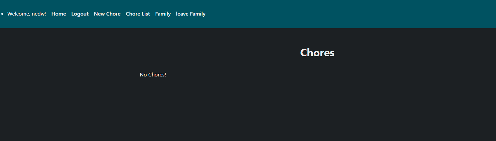

# Sprint 3 - Developing a Minimum Viable Product (MVP)

## Sprint Goals

Continue to develop the web application to the point that it provides all key functionality of the system. Test and refine it so that it can serve as the basis for the final phase of development.

### Specific Goals

- Test user account functionality:
    - Check that users can successfully create an account.
    - Test that users can log in to their existing accounts.

- Test family management:
    - Check that users can create a family and become its owner.
    - Test that a unique family code is generated.
    - Check that users can join an existing family using its code.
    - Ensure joining users are assigned the correct member role.

- Test chore management:
    - Check that owners can create new chores.
    - Ensure newly created chores appear in the chore list.
    - Test editing, completing and deleting chores.

- Identify and fix problems:
    - Test that each feature works as intended.
    - Identify errors and make improvements based on testing results.
    - Ensure user roles and permissions are assigned correctly.

## Testing User Sign-up and Login

I will test to see if a user can create an account and then log into that account

### Changes / Improvements

No improvements or changes were required because the feature worked as expected as the test results showed it worked as intended

## Testing Create Family

I will be testing to see if creating a family makes you the owner and generates a code

### Changes / Improvements

No improvements or changes were required because the feature worked as expected as the test results showed it worked as intended

## Testing Joining Family

I will be testing to see if joining an already made family with a family code works and sets the users role to member

### Changes / Improvements

With the previous version it set the users role as a owner which is bad after some searching in the code I found the issue

## Testing add chore and if it goes into the chorelist

I will be testing to see if adding a chore shows the chore in the chore list page

### Changes / Improvements

With the previous version I wanted to allow options to set the chore complete and edit while keeping the delete button

## Sprint Review

This sprint helped move the project foward lots because it helped me see that it had some issues and Ideas that I do not like allowing for my website 
to feel and look more complete for the next part
