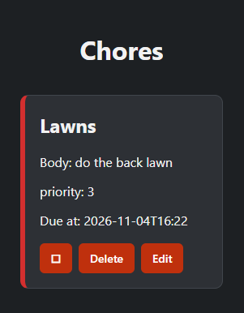

# Sprint 4 - Developing a Refined and Complete System

## Sprint Goals

Develop the system until it is fully featured, with a refined UI and it satisfies the requirements. The system will be fully tested at this point.

### Specific Goals

**Edit these goals as needed**

- Refine the design and UI of the website
- Refine the user experience (UX) of the system
- Perform final, full-system testing

## Testing Forms e.g. signup and add chore

I am testing to see how my forms look like without any css and then design it to fit my website I will pick signup and add chore forms

### Sign-up page

### Add a new chore page

### Changes / Improvements

As a result of the testing I changed a lot to do with the forms making it look in my opinion fresh and satisfying these images show the differences these themes and styles
all appear on every form on the website

### Sign-up page

### Add a new chore page

## Testing Family page

I am testing the family page to see how the final page looks like without any css

### Changes / Improvements

I changed a lot of the css and look to the family list because the old one wasnt very good looking or interesting

## Testing Chore page

I am testing to see how my chore page looks without css because it is functioning now properly then will make it look good

### Changes / Improvements

I change many different things to finalise how I imagined the chore list to look like and I believe it is pretty nice by adding boxes to seperate
each chore to giving colours to different priority levels

## ETC...

## Sprint Review

Replace this text with a statement about how the sprint has moved the project forward - key success point, any things that didn't go so well, etc.

