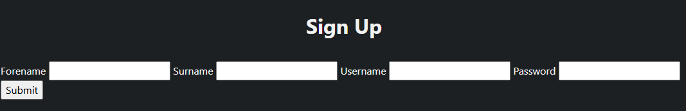
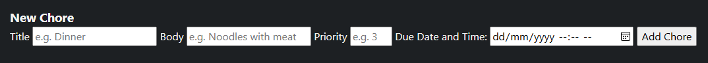
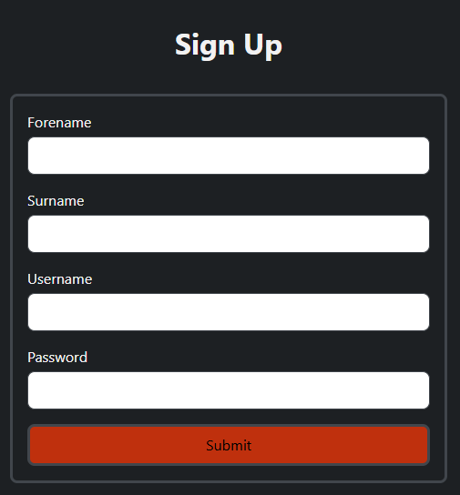
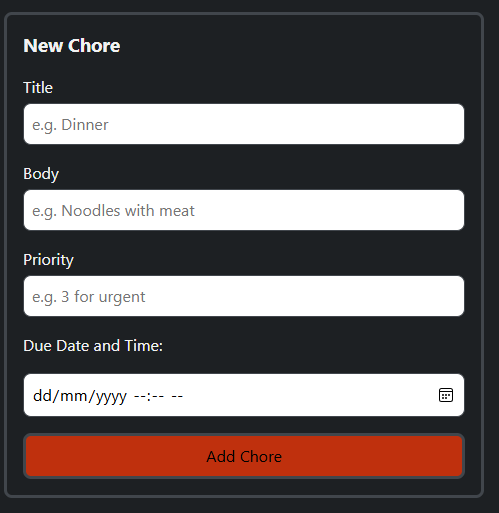
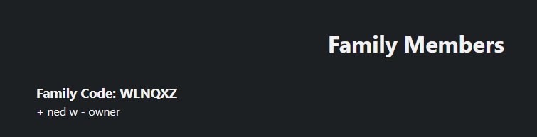
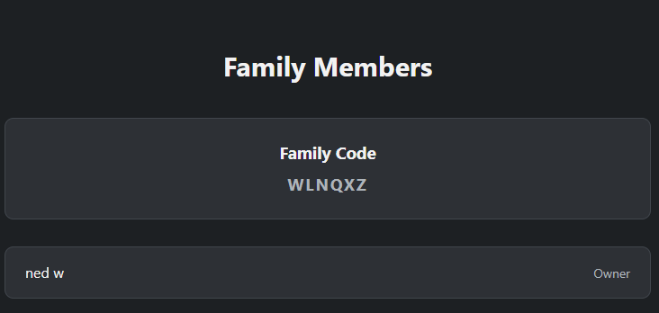
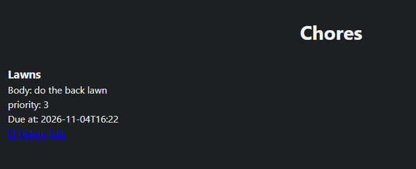

# Sprint 4 - Developing a Refined and Complete System

## Sprint Goals

Develop the system into its final version by improving the website's design, refining the user experience and ensuring all features work correctly. Complete final testing to make sure the system meets all requirements.

### Specific Goals

- Improve the overall design and appearance of the website, including forms, the family page and the chore list.
- Make the website consistent by using the same colours, layouts and styling across all pages.
- Improve the user experience by making the website easier to navigate and use.
- Check that all features work correctly, including family management, chore creation, chore completion and the points system.
- Perform final testing to identify and fix any remaining bugs or problems.
- Ensure the finished system meets all project requirements.

## Testing Forms e.g. signup and add chore

I am testing to see how my forms look like without any css and then design it to fit my website I will pick signup and add chore forms

### Sign-up page

### Add a new chore page

### Changes / Improvements

As a result of the testing I changed a lot to do with the forms making it look in my opinion fresh and satisfying these images show the differences these themes and styles
all appear on every form on the website

### Sign-up page

### Add a new chore page

## Testing Family page

I am testing the family page to see how the final page looks like without any css

### Changes / Improvements

I changed a lot of the css and look to the family list because the old one wasnt very good looking or interesting

## Testing Chore page

I am testing to see how my chore page looks without css because it is functioning now properly then will make it look good

### Changes / Improvements

I change many different things to finalise how I imagined the chore list to look like and I believe it is pretty nice by adding boxes to seperate
each chore to giving colours to different priority levels

## Sprint Review

This sprint definately was the one that helped me the most to determine whether the style would do a huge difference and turns out it definately does I really like the
final system.

