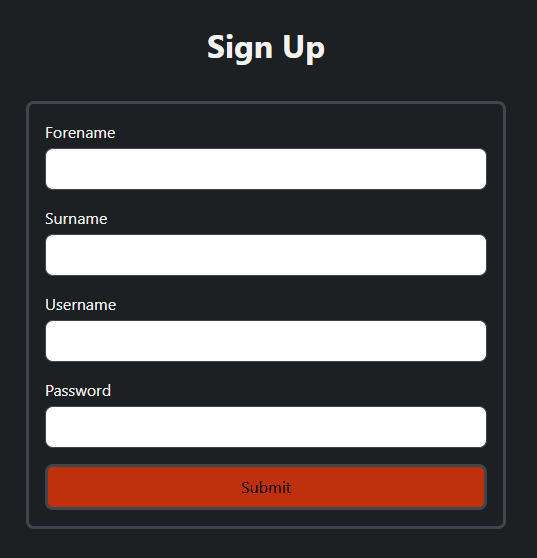

# Project Final Review and Reflection

## Addressing Relevant Implications

### Usability

To address this implication I made sure to think as a user that would first open the website and be able to use it well by making it have simple instructions
clear buttons and where each click would take you
With these screenshots you can see that the form is easy to use and straight forward:

### Privacy

To address this implication I made sure to safely store information that could harm the user and that the website only asks for infomation from the user that
is important and not unnecessary information that could cause the use harm.
As you can see with the screenshot when the user is creating an account it doesn't ask for unnecessary information

### End-User

Since families would be using the website, I made sure to write it for all ages and have obvious paths of where each link or section went to while also thinking
of the ages
As you can see by the screenshot I made the chores page for example easy to read and simple which younger users shouldn't have a problem learning

### Aesthetics 

I made my aesthetics of my website dark and more colorful for the interactive buttons so that users can clearly see buttons and while making the website not
painful to look at being easy on the eyes
As you can see in the screenshot I made the colors nice to look at so it isn't superbright and color coded for the priority and buttons.

### Functionality

I made my website functional by not only being sure it works but to make sure that the user can use it quickly so that they dont get annoyed by it or frustrated 
that it takes mulitple processes just to complete a chore
As you can see by the gif going from logging in to creating a new chore or showing the list of chores all took around 3 clicks while also making sure it worked.

## Overall Review

Replace these words with a brief review of how the project went in terms of:

- What went well in my project was that many of my ideas happened and was easy to complete and I like the finished result.

- What didnt go great was that I wanted a whole leaderboard and point system but I ran out of time and decided families could just do it themselves.

- The testing and trialling did impact the final systems from changing my ideas that I started out with but I believe it changed it for the better.

- If I could do anything differently I would start with the stuff that is easy first and only focus on one part at a time to give me more time later on.

