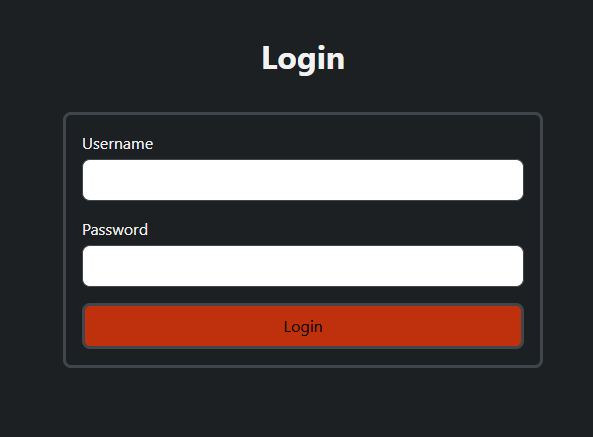
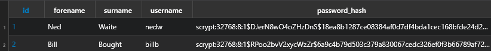
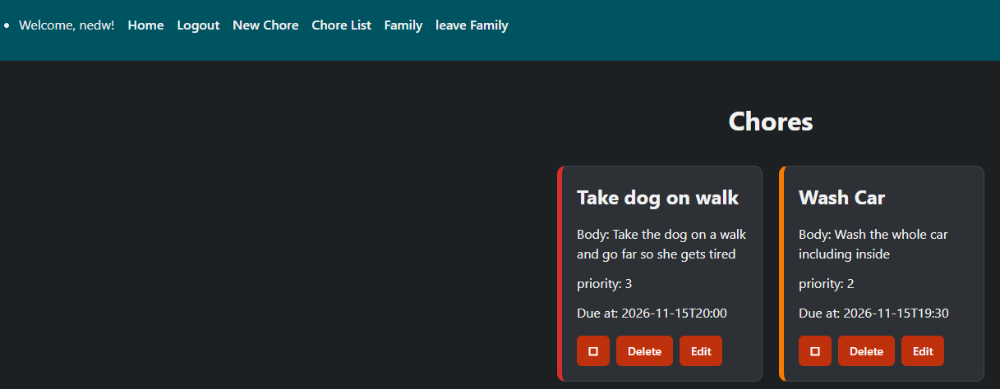
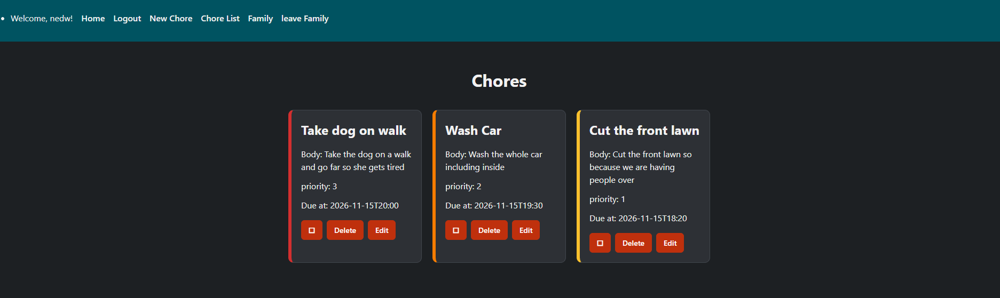

# Project Final Review and Reflection

## Addressing Relevant Implications

### Usability

To address this implication in my final system I made sure to think as a user that would first open the website and be able to use it well by making it have simple instructions
clear buttons and where each click would take you instead of confusing paths or options
With these screenshots you can see that the form is easy to use and straight forward:

### Privacy

To address this implication in my final system I made sure to safely store information that could harm the user and that the website only asks for information from the user that
is important and not unnecessary information that could cause the use harm.
As you can see with the screenshot when the user is creating an account it doesn't ask for unnecessary information

As you can see with this screenshot the password is stored as a hash so that it is safe and secure

### End-User

To address this implication in my final system I made sure to think about families that would use the website, how I addressed this implication was by thinking about younger ages that are impatient and lazy
and making obvious paths to each location of the website so it is quick and simple while also engaging.
As you can see by the screenshot I made the chores page for example easy to read and simple which younger users shouldn't have a problem learning

### Aesthetics 

To address this implication in my final system I made sure to make the aesthetics of my website have a dark body but more colorful colors for the interactive buttons so that users can clearly see buttons
this makes the website not annoying to look at being easy on the eyes which helps lots of users.
As you can see in the screenshot I made the colors nice to look at so it isn't superbright and color coded for the priority and buttons.

### Functionality

To address this implication in my final system I made sure to make the website functional by not only being sure it works but to make sure that the user can use it quickly so that they dont
get annoyed by it or frustrated that it takes multiple processes just to complete a chore without wasting their time because otherwise why would they need the site.
As you can see by the gif going from logging in to creating a new chore or showing the list of chores all took around 3 clicks while also making sure it worked.

## Overall Review

- What went well in my project was that many of my ideas happened and was easy to complete and I like the finished result.

- What didnt go great was that I wanted a whole leaderboard and point system but I ran out of time and decided families could just do it themselves.

- The testing and trialling did impact the final systems from changing my ideas that I started out with but I believe it changed it for the better.

- If I could do anything differently I would start with the stuff that is easy first and only focus on one part at a time to give me more time later on.

